# Google Antigravity Design System & Architecture Specification
## Personal Portfolio for Harsh Lagwal — AI & Machine Learning Engineer

---

### Executive Summary

This document establishes the complete architectural and design blueprint for transforming **Harsh Lagwal’s portfolio** from a desktop-simulated operating system (macOS/iOS interface) into an elite, production-grade, web portfolio inspired by the **Google Antigravity Design System**.

The redesigned portfolio embodies the hallmarks of Google’s product design language:
- **Spacious, bright, and minimal:** Generous white surfaces, high-contrast ink typography, and breathing room.
- **Refined Material/Google aesthetic:** Google Sans Flex typography, hairline neutral borders (`#E5E7EB`), soft cool gray-blue accents (`#B7BFD9`), and pill-shaped controls (`9999px`).
- **Authentic and verified:** 100% real data from IIT Patna, Rayat Bahra University, real production clients (ATC Constructions), and live projects (WanderLust.ai, CodeChaska). No simulated data or exaggerated metrics.
- **Accessible, fast, and responsive:** Instant recruitment discoverability with seamless transitions across mobile (320px–390px), tablet (768px–1024px), and desktop (1280px–1440px+).

---

## 1. Visual Design System & Design Tokens

### 1.1 Color Palette
The interface is anchored by white surfaces with near-black ink text, accented strictly with cool gray-blue and subtle neutral borders. Saturated gradients and neon cyberpunk glows are entirely eliminated.

| Token Name | Hex Value | Role / Usage |
| :--- | :--- | :--- |
| `--color-primary` (Primary Ink) | `#121317` | Display headlines, primary navigation text, dark pills, and high-emphasis elements. |
| `--color-secondary` (Gray-Blue) | `#B7BFD9` | Primary CTA button fill, soft atmospheric accents, active indicator pills. |
| `--color-tertiary` (Subtle Neutral) | `#E5E7EB` | Hairline dividers, subtle borders, card outlines, hover states. |
| `--color-background` (Page Base) | `#FFFFFF` | Core page surface (Light Mode). |
| `--color-surface` (Card Surface) | `#FFFFFF` | Clean white card backgrounds. |
| `--color-surface-soft` (Subtle Tint)| `#F8F9FC` | Section alternate backgrounds, metric badge containers, subtle pill backdrops. |
| `--color-text-secondary` | `#5F6368` | Body copy, secondary metadata, captions, timestamps. |
| `--color-border` (Hairline) | `#E5E7EB` | 1px border for cards, inputs, and section dividers. |
| `--color-error` | `#D93025` | Form validation errors and destructive states. |

#### Dark Mode Balanced Counterpart
The light theme remains the primary reference. The dark mode counterpart uses restrained, near-black surfaces rather than pitch black:
- Background: `#131314`
- Surface: `#1E1F20`
- Surface Soft: `#252629`
- Text Primary: `#E3E3E3`
- Text Secondary: `#9AA0A6`
- Border: `#2E3134`
- Accent: `#8AB4F8` / `#B7BFD9`

---

### 1.2 Typography System

The primary typeface is **Google Sans Flex** / **Google Sans**, with **Inter** and modern system sans-serif as fallbacks.

```css
--font-display: "Google Sans Flex", "Google Sans", "Inter", -apple-system, BlinkMacSystemFont, "Segoe UI", Roboto, sans-serif;
--font-body: "Google Sans Flex", "Google Sans Text", "Inter", -apple-system, BlinkMacSystemFont, "Segoe UI", Roboto, sans-serif;
--font-mono: "JetBrains Mono", SFMono-Regular, Menlo, Monaco, Consolas, monospace;
```

#### Typography Scale & Hierarchy

| Role | Font Size | Weight | Line Height | Letter Spacing | Applied Elements |
| :--- | :--- | :--- | :--- | :--- | :--- |
| **Headline Display** | `clamp(44px, 6vw, 76px)` | 400–450 | `1.1` | `-0.02em` | Hero main title |
| **Headline Large** | `clamp(30px, 4vw, 42px)` | 450 | `1.15` | `-0.015em`| Section Headings (`h2`) |
| **Headline Medium** | `20px–24px` | 500 | `1.25` | `0px` | Card Titles, Major Roles |
| **Headline Small** | `18px` | 500 | `1.3` | `0px` | Subheadings, Modal Titles |
| **Body Large** | `17px–18px` | 400 | `1.55` | `0.01em` | Hero intro, About lead narrative |
| **Body Medium** | `15px–16px` | 400 | `1.5` | `0.01em` | Project descriptions, Experience bullets |
| **Body Small** | `13px–14px` | 400 | `1.45` | `0.01em` | Footnotes, tag descriptions |
| **Navigation** | `14px–15px` | 400–450 | `1.4` | `0px` | Navbar links (Sentence case) |
| **Label Small (Chips)** | `11px–12px` | 500 | `1.2` | `0.05em` | Category tags, Status badges |

---

### 1.3 Shape Language (Border Radii)

Google Antigravity creates harmony between sharp architectural container lines and soft, inviting interactive controls:
- **Pill Controls (`rounded-full` / 9999px):** All buttons (primary, secondary, utility), category filter chips, search badges, status indicators.
- **Card Frames (`rounded-xl` / 12px–16px):** Project cards, education cards, experience containers.
- **Subtle Containers (`rounded-md` / 8px):** Code snippets, inner tech badges, metadata boxes.

---

### 1.4 Elevation, Hairlines & Spacing

- **Borders over Shadows:** Strict single-pixel neutral borders (`border border-[#E5E7EB] dark:border-[#2E3134]`).
- **Shadows:** Extremely faint ambient shadow for hover states (`box-shadow: 0 4px 20px -2px rgba(18, 19, 23, 0.05)`).
- **Disciplined Spacing Scale:**
  - Micro: `8px` (`gap-2`)
  - Compact: `16px` (`gap-4`, `p-4`)
  - Component: `24px` (`gap-6`, `p-6`)
  - Block: `36px` (`my-9`)
  - Section Spacing: `72px` to `88px` (`py-20 md:py-24`)
- **Container Max-Width:** `1200px` centered (`max-w-6xl mx-auto px-6`), providing balanced margins without horizontal crowding.

---

## 2. Architecture & State Management

### 2.1 Transition from Simulated OS to Modern Web Portfolio

#### Previous Architecture
- `App.jsx` rendered `<MacDesktopPortfolio />` inside an `overflow-hidden select-none bg-black` window on desktop and `<MobilePortfolio />` on mobile.
- Important career information (Resume, Projects, About) was buried behind simulated desktop windows (FinderApp, NotesApp, TerminalApp, PreviewApp) and desktop icons.
- Non-standard scroll behavior and poor accessibility for recruiters.

#### Target Architecture
- **Single Cohesive Web Experience:** Seamless vertical scrolling with smooth Lenis-powered velocity, working identically across Desktop, Tablet, and Mobile.
- **Direct Recruiter Discoverability:** Key links (Resume PDF, GitHub, LinkedIn, Email, Projects, Certifications) are accessible within 1 click directly from the Hero and Navbar.
- **Interactive Engineering Features Kept:**
  - Fast **Resume Modal** with full preview + 1-click Google Drive download.
  - Interactive **Certificate Viewer Modal** with high-resolution document preview and credential links.
  - Optional **Terminal / AI Console** as a floating utility action for visitors who appreciate technical flair, without restricting standard page navigation.

```mermaid
graph TD
    App[App.jsx] --> ThemeProvider[ThemeProvider]
    ThemeProvider --> MainLayout[Main Page Container]
    
    MainLayout --> Navbar[1. Navbar: Brand + Nav Links + Theme + Resume CTA]
    MainLayout --> Hero[2. Hero: Headline + Real Cutout + Verified Badges + Dual CTAs]
    MainLayout --> Proof[3. Proof Snapshot: Verified Numbers & Institutions Ribbon]
    MainLayout --> About[4. About: Philosophy + IIT Patna & Rayat Bahra Journey]
    MainLayout --> Projects[5. Featured Projects: Dynamic Filters + Flagship Cards + Direct Links]
    MainLayout --> Tech[6. Technical Expertise: 4 Grouped Stacks with Minimalist Chips]
    MainLayout --> Experience[7. Experience Timeline: Upto Skills + SpectoV + Edunet + eDC IIT Delhi]
    MainLayout --> Education[8. Education: IIT Patna MBA DS + Rayat Bahra B.Tech CSE]
    MainLayout --> Certs[9. Certifications Gallery: NVIDIA, ISRO, Google, Anthropic + Modal]
    MainLayout --> Philosophy[10. Engineering Principles: Production First, Reliability, Token Economy]
    MainLayout --> Contact[11. Contact & Collaboration: Formspree Live Form + Direct Channels]
    MainLayout --> Footer[12. Footer: Minimal Antigravity Signature + Back to Top]

    MainLayout -.-> ResumeModal[Resume Modal]
    MainLayout -.-> CertModal[Certificate Modal]
```



---

## 3. Section-by-Section Component Blueprint

### 3.1 Top Navigation (`Navbar.jsx`)
- **Brand:** `Harsh Lagwal` (Google Sans Medium, 16px, near-black ink `#121317`).
- **Nav Links:** `About`, `Projects`, `Experience`, `Skills`, `Education`, `Certifications`, `Contact`.
- **Active State:** Understated pill indicator or subtle color highlight (`#121317` with light gray-blue dot).
- **Utility Actions:**
  - Theme Toggle (Light / Dark).
  - "View Résumé" pill button (`button-secondary`: `#121317` fill, `#FFFFFF` text, `rounded-full`).
  - Mobile Menu Hamburger (clean animated overlay on mobile).

### 3.2 Hero Section (`HeroSection.jsx`)
- **Availability Pill:** `"● Available for AI/ML Opportunities"` with subtle emerald pulse.
- **Headline (Display 72px):**
  > Building intelligent systems.  
  > Designing what's next.
- **Supporting Narrative:**
  > "I'm Harsh Lagwal, an AI engineer and software builder focused on Generative AI, machine learning, intelligent automation, and practical digital products."
- **Dual Pill CTAs:**
  - Primary (`button-primary`): `"Explore my work"` (smooth scroll to `#projects`, `#B7BFD9` background, `#121317` text, `rounded-full`).
  - Secondary (`button-secondary`): `"View résumé"` (opens interactive modal, `#121317` background, `#FFFFFF` text, `rounded-full`).
- **Right / Composition:** Real portrait cutout (`src/assets/harsh-cutout.png` or `Harsh-portfolio.jpg`) with subtle Google Antigravity geometry (soft hairline card backing, minimal floating tech tags: "PyTorch & Gemini 1.5", "IIT Patna MBA DS", "Sub-100ms Inference").

### 3.3 Proof & Institutional Snapshot (`ProofRibbon.jsx`)
- Institutional Trust row: IIT Patna (MBA Decision Science), Rayat Bahra University (B.Tech CSE), Google, ISRO, NVIDIA, Anthropic, OpenAI, Microsoft.
- Verified Metrics:
  - `4+` AI/ML Industry Internships & Roles
  - `8+` Production & Open-Source Projects
  - `8+` Verified Technical Credentials
  - `2026–2028` IIT Patna MBA Scholar

### 3.4 About Me (`About.jsx`)
- **Headline:** *"Engineering intelligent systems with purpose."*
- **Content:**
  - Concise technical narrative on moving machine learning models from prototype to production.
  - Integration of Decision Science with Generative AI and deep neural architectures.
  - Authentic education grounding: IIT Patna & Rayat Bahra University.

### 3.5 Featured Projects Showcase (`Projects.jsx`)
- **Filter Pills:** `All`, `Generative AI`, `Machine Learning`, `Computer Vision & Tools`, `Client & Web Apps`.
- **Card Hierarchy:**
  - **Flagship Projects (Larger editorial feature card):**
    1. **WanderLust.ai:** Autonomous AI travel planner powered by Google Gemini 1.5 Pro, dynamic maps, budget intelligence.
    2. **ATC Constructions Portal:** Live commercial client platform for government contractor Amit Thakur (live demo: `atc-constructions.vercel.app`).
    3. **CodeChaska:** Cyberpunk interactive coding platform with 360 missions and visual 2D algorithm tracers (live demo: `code-chaska.vercel.app`).
  - **Secondary High-Impact Projects:**
    4. **CareerCraft AI:** Predictive ML skill-gap analysis & trajectory recommender.
    5. **Healthcare Assistant Chatbot:** NLP triage assistant with sub-100ms inference.
    6. **Object Detection System:** OpenCV DNN + SSD MobileNet v3 with 30+ FPS real-time tracking.
    7. **Shree Sheetla Mata Mandir Portal:** Community platform with live darshan and heritage archives.
    8. **AlgoFlow VS Code Extension:** Code-to-flowchart real-time visualizer with Big-O analysis.
- **Card Elements:** Tag, Title, Summary, 3–5 Tech Pills, GitHub Repository button, Verified Live Demo button (where live URL exists).

### 3.6 Technical Expertise (`Skills.jsx`)
- **Headline:** *"Tools for turning ideas into working systems."*
- Grouped into 4 clean cards with subtle borders:
  1. **AI & Machine Learning:** Generative AI, PyTorch, TensorFlow, Deep Learning, NLP, Gemini 1.5 Pro, OpenCV DNN, Hugging Face, LangChain, Prompt Engineering.
  2. **Languages:** Python, JavaScript (ES6+), TypeScript, SQL, C++, HTML5 & CSS3.
  3. **Frameworks & Libraries:** React, FastAPI, Node.js, Express, Tailwind CSS, Framer Motion, Vite.
  4. **Tools & Cloud Dev:** Git & GitHub, Docker, Microsoft Azure ML, MongoDB, Linux/Bash, Vercel, Postman.

### 3.7 Professional Experience (`Experience.jsx`)
- Timeline presentation with verified records:
  - **AI / ML Intern** @ Upto Skills (Jan 2026 – Apr 2026) — Deep learning algorithms, predictive ML pipelines. Includes Experience Letter & Certificate links.
  - **Campus Ambassador** @ eDC IIT Delhi (Dec 2025 – Feb 2026) — AI hackathons & mentorship. Includes verified certificate link.
  - **Generative AI Engineer** @ SpectoV (Jul 2025 – Sep 2025) — Custom LLM orchestration, structured prompt architectures. Includes verified certificate link.
  - **AI Azure Intern** @ Edunet Foundation (Jun 2025 – Jul 2025) — Azure ML Studio computer vision deployments. Includes verified certificate link.

### 3.8 Education (`Education.jsx`)
- **IIT Patna (Indian Institute of Technology, Patna):** Master of Business Administration (MBA) in Decision Science (2026 – 2028). Focus: Quantitative Business Modeling, Decision Science, AI Leadership & Big Data Analytics. Includes official IIT Patna Seal asset.
- **Rayat Bahra University:** B.Tech in Computer Science & Engineering (2022 – 2026). Aggregate: 76.8% First Class.

### 3.9 Certifications & Honors (`Certifications.jsx`)
- Clean grid featuring authentic certificates from Google, Anthropic (Model Context Protocol), NVIDIA, ISRO, OpenAI, Microsoft, and TATA.
- Interactive modal previewing credentials with direct Google Drive access.

### 3.10 Engineering Philosophy (`Philosophy.jsx`)
- Three core pillars:
  1. **Production-First AI:** Low-latency microservices with FastAPI & Docker rather than isolated notebooks.
  2. **Token Economics & Quantization:** Efficient prompt architectures, KV-cache awareness, and targeted fine-tuning.
  3. **Guardrails & Determinism:** Structured outputs, Pydantic validation, and fallback mechanisms for autonomous agents.

### 3.11 Contact & Collaboration (`Contact.jsx`)
- **Headline:** *"Have an interesting problem? Let's build."*
- Interactive quick-intent buttons ("Full-Time AI Role", "GenAI Project", "Research & Collab", "Quick Chat").
- Functional Formspree submission (`https://formspree.io/f/xdenprwy`) with input validation, sending state, and success/error feedback.
- Direct links: Email (`Harshlagwal2005@gmail.com`), LinkedIn, GitHub, WhatsApp.

### 3.12 Footer (`Footer.jsx`)
- Minimal Antigravity identity: `Harsh Lagwal • AI & Machine Learning Engineer`.
- Navigation links, social links, and "Back to top" action with dynamic copyright year.

---

## 4. Motion & Micro-Interactions Specification

All animations will be powered by Framer Motion, adhering to these rules:
- **Duration:** 160ms – 240ms for UI controls; 400ms – 600ms for entrance reveals.
- **Easing:** `cubic-bezier(0.16, 1, 0.3, 1)` (smooth, natural deceleration without heavy bounce).
- **Page Entrance:** Soft vertical lift (16px–24px) with subtle fade-in.
- **Cards:** Subtle border color transition (`#E5E7EB` → `#B7BFD9`) and minimal scale (`scale: 1.01`).
- **Category Filter:** Soft layout transition without sudden scroll jumps.
- **Accessibility:** Full respect for `prefers-reduced-motion` media query.

---

## 5. Responsive Breakpoint Plan

| Breakpoint | Screen Width | Layout Adjustments |
| :--- | :--- | :--- |
| **Desktop XL** | 1280px–1440px+ | Centered 1200px container, 2-column editorial hero, 2–3 column project grid. |
| **Laptop / Tablet L** | 1024px–1279px | 2-column project grid, scaled typography, comfortable side padding (32px). |
| **Tablet Portrait** | 768px–1023px | Stacked hero (text above portrait), 2-column cards, mobile-friendly navbar. |
| **Mobile Standard** | 390px–767px | Full single-column flow, touch-friendly 44px+ button targets, collapsible navigation. |
| **Compact Mobile** | 320px–389px | Compact margins (16px), fluid clamp() typography, zero horizontal overflow. |

---

## 6. Implementation & Validation Plan

1. **Tokens & Theme Foundation (`src/index.css` & `src/context/ThemeContext.jsx`):**
   - Configure Google Antigravity tokens: colors, Google Sans typography, hairline borders, and pill radii.
   - Set Light Mode as standard primary reference with sleek dark mode support.
2. **Main Application Entry (`src/App.jsx`):**
   - Replace the macOS window container with the unified Antigravity responsive page layout.
   - Wire smooth Lenis scrolling.
3. **Core Component Refinements:**
   - Redesign `Navbar.jsx`, `HeroSection.jsx`, `About.jsx`, `Projects.jsx`, `Skills.jsx`, `Experience.jsx`, `Education.jsx`, `Certifications.jsx`, `Contact.jsx`, and `Footer.jsx` into the strict Antigravity visual language.
   - Clean up any unused imports or variables to satisfy ESLint.
4. **Validation & Verification:**
   - Execute `npm run build` and ensure clean bundle generation.
   - Execute `npm run lint` and verify zero errors.
   - Test in browser across desktop, tablet, and mobile views.
