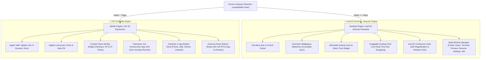

#  Harsh Lagwal — Dual-Engine OS Portfolio Platform
### macOS Sonoma Desktop & iOS 18 Mobile Operating System Architecture

<div align="center">

[](https://portfolio-harsh-lagwal.vercel.app/)
[](https://github.com/harshlagwal/portfolio-)
[](https://react.dev/)
[](https://vitejs.dev/)
[](https://tailwindcss.com/)
[](https://www.framer.com/motion/)
[](https://threejs.org/)

<p align="center">
  <b>A state-of-the-art, high-performance web platform simulating Apple macOS Sonoma/Sequoia for desktop devices and Apple iOS 18 for mobile devices. Engineered to showcase Harsh Lagwal's AI/ML systems, IIT Patna MBA Decision Science scholarship, and full-stack engineering achievements.</b>
</p>

</div>

---

## 🏛️ System Architecture Overview

The application features a responsive **Dual-Engine Operating System Architecture** that auto-detects viewport dimensions and renders a tailored operating system environment:



---

## 🚀 Key Innovations & Engineering Highlights

### 1. 🔄 Live Real-Time Slot Shifting & Drag Physics
- **The Challenge**: Traditional drag-and-drop implementations either let icons overlap on top of each other or only rearrange items after the drag ends.
- **The Solution**: 
  - An active `onDrag` listener tracks pointer coordinates relative to all slot center positions measured via DOM bounding rects.
  - When the pointer crosses within a 50px snap radius of a neighboring slot (throttled at 160ms for silky-smooth 60 FPS transitions), the array state immediately splices the dragged element into the target index.
  - Neighboring icons smoothly slide out of the way into their new positions using Framer Motion's spring-physics layout engine (`damping: 25, stiffness: 350`), while the dragged element remains pinned under the user's touch.
  - Supported identically on both **Mobile iOS Homescreen** and **Desktop macOS Canvas**.

### 2. 🛡️ Bulletproof Drag vs. Tap Conflict Prevention
- **The Challenge**: Releasing a drag gesture frequently causes mobile browsers and pointer event systems to fire an unwanted `onClick` / `onTap` event, accidentally launching modals.
- **The Solution**:
  - Implemented an `isDraggingRef` combined with a 6px drag movement vector threshold.
  - When active dragging occurs, `isDraggingRef.current` locks to `true` and remains locked for a 220ms cooldown period post-release.
  - All click and tap handlers verify `!isDraggingRef.current` before dispatching window or sheet opening events.
  - Stationary taps open apps instantly (<5ms latency), while drag gestures never trigger accidental app launches.

### 3. ⚡ 60–120 FPS Hardware-Accelerated Performance
- **Zero Full-Viewport Rasterization**: Eliminated CSS `filter: brightness(...)` during sheet slide-ups, which previously forced mobile WebKit and Blink to re-rasterize the entire viewport on every frame.
- **GPU Compositor Pipeline**: All modal sheets and grid translations use hardware-accelerated transforms (`transform-gpu will-change-transform`).
- **Smooth Exit Animations**: Fully orchestrated `AnimatePresence` lifecycle handling so bottom sheets slide down seamlessly on swipe-to-dismiss without sudden unmount flashes.

### 4. 🌐 3D WebGL GitHub Contribution Skyline
- Implemented via Three.js with custom procedural geometry mapping GitHub contribution commits into extruded 3D skyscraper pillars.
- Ambient lighting, orbit controls, custom hover raycasters, and automatic WebGL fallback for low-power mobile devices.

### 5. 🔊 Web Audio Synthesizer Sound Effects
- Pure programmatic Web Audio API sound synthesis (`soundEffects.js`):
  - `playPop()`: Crisp Apple-style pop on slot snap and icon select.
  - `playClick()`: Subtle tactile feedback on menu selections.
  - `playSwoosh()`: Fluid sound on window open and maximize.
  - `toggleSound()`: Global mute toggle persisted in settings.

### 6. 🖼️ Official Apple Sonoma/Sequoia continuous-curvature Squircles
- All app icons are framed in Apple's continuous squircle curvature (`rounded-[22.5%]`) with official macOS Sonoma/Sequoia artwork and ambient multi-layered drop shadows.

---

## 📱 Mobile UI Application Layout (Zero Duplicate Apps)

The mobile experience features a non-overlapping, high-utility distribution across the homescreen and the bottom dock:

| Zone | Apps | Purpose |
| :--- | :--- | :--- |
| **Homescreen Grid (4x2)** | 1. 📁 **Projects** (`finder`) | Project Showcase & Deep Architecture Specs |
| | 2. 📝 **About Me** (`notes`) | Bio, Experience, Tech Arsenal & Philosophy |
| | 3. 🏅 **Certificates** (`preview`) | Verified Credentials (Google, ISRO, NVIDIA, etc.) |
| | 4. 📟 **Terminal** (`terminal`) | Interactive iTerm2 Shell with Linux Commands |
| | 5. 📄 **Resume (CV)** (`resume`) | High-res Google Drive Verified Embed & Actions |
| | 6. ⚙️ **Settings** (`settings`) | Wallpapers, Appearance (Dark/Light), Audio & Specs |
| | 7. ✨ **Siri AI** (`siri`) | Apple Intelligence Interactive Assistant |
| | 8. 🎓 **IIT Patna** (`iitpatna`) | MBA in Decision Science & Academic Profile |
| **Bottom Dock (4 Apps)** | 1. 📞 **Phone** (`phone`) | Direct Call / WhatsApp (+91 6230624011) |
| | 2. ✉️ **Mail Harsh** (`mail`) | Direct Email & Message Delivery (Formspree) |
| | 3. 🐙 **GitHub 3D** (`github`) | Three.js Contribution Skyline & Repositories |
| | 4. 💼 **LinkedIn** (`linkedin`) | Official LinkedIn Profile Direct Launch |

---

## 🛠️ Technology Stack & Dependencies

```json
{
  "Core Framework": "React 19, JavaScript (ESNext), Vite 7",
  "Styling & Tokens": "Tailwind CSS v4, Modern Design Tokens, Frosted Glassmorphism",
  "Motion & Physics": "Framer Motion 12 (Spring Dynamics, Layout Animations)",
  "3D Graphics": "Three.js, WebGL Raycasters, Ambient Shaders",
  "Icons & Visuals": "Lucide React, Apple macOS Official App Icon Artwork",
  "Sound Engine": "Web Audio API (Synthesized Real-Time Audio FX)",
  "Deployment": "Vercel Global Edge Network with CI/CD"
}
```

---

## 📁 Repository Directory Structure

```text
portfolio-harsh-lagwal/
├── public/
│   ├── favicon.svg                   # Circular Photo Favicon with Apple Cyan Ring
│   ├── harsh-avatar.jpg              # High-Resolution Portrait Avatar
│   ├── og-image.jpg                  # OpenGraph & Twitter Social Card
│   ├── apple_hello_normalized.svg    # Normalized Apple "hello" Script
│   └── sitemap.xml                   # SEO Discovery Sitemap
├── src/
│   ├── assets/
│   │   ├── Harsh-portfolio.jpg       # Master Portfolio Portrait Photo
│   │   ├── icons/                    # Official Apple macOS/iOS Squircle Icons
│   │   └── wallpapers/               # High-Res macOS & iOS Portrait Wallpapers
│   ├── components/
│   │   ├── macos/                    # macOS Sonoma Desktop System
│   │   │   ├── Desktop.jsx           # Canvas, Wallpapers, Live Slot Reorder
│   │   │   ├── Dock.jsx              # macOS Magnifying Dock & Active Dots
│   │   │   ├── MenuBar.jsx           # Top Bar, Apple Logo, Clock, Status Menus
│   │   │   ├── WindowFrame.jsx       # Floating Windows (Traffic Lights, Minimize, Maximize)
│   │   │   ├── MacDesktopPortfolio.jsx # Desktop Master Controller
│   │   │   ├── SiriIntelligenceOverlay.jsx # Apple Intelligence Ambient Glow
│   │   │   └── apps/                 # Desktop Window Applications
│   │   │       ├── FinderApp.jsx     # Projects Directory & Details
│   │   │       ├── NotesApp.jsx      # Story, Arsenal & Background
│   │   │       ├── PreviewApp.jsx    # Certification Gallery
│   │   │       ├── TerminalApp.jsx   # Interactive Linux Shell
│   │   │       ├── ResumeApp.jsx     # Google Drive PDF Embed & Tools
│   │   │       ├── SettingsApp.jsx   # Wallpapers, Dark/Light, Sound, Specs
│   │   │       ├── SafariApp.jsx     # Web Browser Tabs
│   │   │       ├── MailApp.jsx       # Contact Form
│   │   │       ├── SiriApp.jsx       # AI Assistant Chat
│   │   │       └── IITPatnaApp.jsx   # IIT Patna Decision Science Specs
│   │   ├── mobile/                   # iOS 18 Mobile System
│   │   │   ├── MobilePortfolio.jsx   # Mobile Master (4x2 Live Drag Reorder Grid)
│   │   │   ├── MobileBottomDock.jsx  # 4-App Frosted Glass Bottom Dock
│   │   │   ├── MobileBottomSheet.jsx # 60-120fps Gesture-Driven Bottom Sheets
│   │   │   └── MobileIPhoneClock.jsx # Lockscreen Digital Clock & Date
│   │   └── ui/                       # UI Components (Three.js Skyline, Dock)
│   ├── context/
│   │   ├── ThemeContext.jsx          # Dark / Light Theme Provider
│   │   └── WindowManagerContext.jsx  # Multi-Window Coordinate & Depth State
│   ├── data/
│   │   └── portfolioData.js          # Master Data (Projects, Internships, Credentials)
│   └── utils/
│       └── soundEffects.js           # Web Audio API Synthesizer
├── index.html                        # HTML5 Entry with Dynamic Favicon
├── package.json                      # NPM Manifest
└── vite.config.js                    # Vite 7 Bundler Configuration
```

---

## 💻 Local Setup & Development

### Prerequisites
- Node.js `18.0+` or `20.0+`
- npm `9.0+`

### Quick Start
```bash
# 1. Clone the repository
git clone https://github.com/harshlagwal/portfolio-.git
cd portfolio-

# 2. Install dependencies
npm install

# 3. Start local development server with mobile host support
npm run dev -- --host

# 4. Open in browser:
# Local: http://localhost:5173/
# Mobile (Same Wi-Fi): http://<your-lan-ip>:5173/
```

### Production Build
```bash
# Compile and optimize for production
npm run build

# Preview production build locally
npm run preview
```

---

## 👨‍💻 Author & Connect

**Harsh Lagwal**  
*AI & Machine Learning Engineer | MBA Decision Science Scholar @ IIT Patna*  

- 🌐 **Portfolio**: [portfolio-harsh-lagwal.vercel.app](https://portfolio-harsh-lagwal.vercel.app/)
- 💼 **LinkedIn**: [linkedin.com/in/harshlagwal](https://linkedin.com/in/harshlagwal)
- 🐙 **GitHub**: [github.com/harshlagwal](https://github.com/harshlagwal)
- ✉️ **Email**: [Harshlagwal2005@gmail.com](mailto:Harshlagwal2005@gmail.com)
- 📍 **Location**: Hamirpur, Himachal Pradesh, India
