# ⚡ Harsh Lagwal — AI Engineer & Decision Science Scholar

<div align="center">

[](https://portfolio-harsh-lagwal.vercel.app/)
[](https://github.com/harshlagwal/portfolio-)
[](https://react.dev/)
[](https://vitejs.dev/)
[](https://tailwindcss.com/)
[](https://www.framer.com/motion/)

<p align="center">
  <b>A state-of-the-art, high-performance personal portfolio engineered with a Linear-grade web interface and an authentic Apple macOS desktop system. Built to showcase enterprise Generative AI systems, mathematical decision models, and production full-stack engineering.</b>
</p>

</div>

---

## 👨‍💻 Executive Summary

I am an **AI & Machine Learning Engineer** currently pursuing an **MBA in Decision Science at the Indian Institute of Technology, Patna (IIT Patna, 2026–2028)**, backed by a **B.Tech in Computer Science & Engineering from Rayat Bahra University (First Class Distinction, 76.8%)**.

My technical philosophy bridges theoretical deep learning research with robust enterprise deployments. I design and build autonomous multi-agent pipelines, low-latency microservices with FastAPI & PyTorch, and context-optimized LLM workflows with deterministic guardrails.

- 🎓 **IIT Patna**: MBA Scholar in Decision Science, Quantitative Modeling & AI Leadership (2026–2028)
- 🎓 **Rayat Bahra University**: B.Tech in Computer Science & Engineering (2022–2026)
- 💼 **Industry Track Record**: 4+ Industry Roles (Upto Skills, SpectoV, Edunet Foundation, eDC IIT Delhi)
- 🏆 **Enterprise Credentials**: Google Developers, NVIDIA DLI, ISRO IIRS, Microsoft Azure, Anthropic, OpenAI

---

## 🏛️ Architecture & Platform Features

This portfolio is engineered as a unified, dual-experience web application combining a clean **Linear/Apple modern single-page layout** with an interactive **macOS Desktop Operating System**:

```mermaid
flowchart TD
    A["Portfolio Web Platform"] --> B["Modern Linear Experience (Default)"]
    A --> C["macOS Desktop Mode (Interactive Simulator)"]

    subgraph Linear_Experience ["Modern Web Layout"]
        B --> L1["Hero Section with Live Availability Indicator"]
        B --> L2["Proof Ribbon: Continuous Dual Marquee of Verified Partners"]
        B --> L3["Executive About & Engineering Philosophy"]
        B --> L4["Infinite Kinetic Skills Ribbons (Google Sans Typography)"]
        B --> L5["Production Projects Showcase with Live Demos"]
        B --> L6["Experience Timeline with Direct Google Drive Credentials"]
        B --> L7["Academic Foundation: IIT Patna & Rayat Bahra University"]
        B --> L8["Interactive Halftone Wordmark Generative Canvas Footer"]
    end

    subgraph macOS_Desktop [" macOS Desktop Simulator"]
        C --> D1["Menu Bar with Real-time Clock & Battery Status"]
        C --> D2["Draggable Desktop Grid with Physics-based Drag & Drop"]
        C --> D3["Multi-Window Window Manager (Z-index stacking, maximize, minimize)"]
        C --> D4["Native macOS Apps: Finder, Notes, Preview, Terminal, Siri, Settings"]
        C --> D5["Continuous Curvature Squircle Dock with Icon Magnification"]
    end
```



---

## ✨ Key Technical Highlights

### 1. 🎨 Generative Halftone Particle Wordmark Footer
- **Canvas Physics Engine**: Custom HTML5 Canvas wordmark rendered as a responsive halftone grid of dot particles.
- **Spring Restitution & Shockwaves**: Moving the cursor across the canvas displaces particles on calibrated spring physics with dynamic thermal color shifts; clicking triggers a radial shockwave across the grid.
- **Zero Heavy Dependencies**: Implemented natively in TypeScript without external WebGL or physics engine bloat.

### 2. 🛡️ High-Contrast Dark & Light Mode System
- **Curated Palette**: Built with tailored HSL tokens (`#f0f2f5` light, `#090a0d` dark) for comfortable readability.
- **100% Brand Legibility**: All partner and academic seals (IIT Patna, Rayat Bahra University, SpectoV, Edunet Foundation, eDC IIT Delhi, NVIDIA, Google) sit on dedicated contrast containers to guarantee pristine visibility in both dark and light modes.
- **Persistent Preference**: Theme state seamlessly synchronizes with `localStorage` and system media queries.

### 3. ♾️ Smooth Continuous Skills & Partner Ribbons
- **Infinite Dual Marquee**: Partner organizations and technical skills flow smoothly across opposing infinite loops.
- **Zero-Glitch Transitions**: Configured with CSS hardware-accelerated transforms (`transform-gpu will-change-transform`) for 60-120 FPS performance on all mobile and desktop browsers.

### 4. 📂 Direct Verified Document Integration
- Every role and credential card is wired directly to verified institutional evidence (Google Drive experience letters, completion certificates, and accreditation IDs).
- Integrated into both the main web feed and the native macOS `Preview.app` simulator.

---

## 🛠️ Technical Arsenal

| Category | Technologies & Frameworks |
| :--- | :--- |
| **Generative AI & LLMs** | Gemini 1.5 Pro, DeepSeek, Claude 3.5, OpenAI GPT-4o, LangChain, LlamaIndex, RAG Pipelines, Multi-Agent Orchestration, Prompt Engineering |
| **Deep Learning & ML** | PyTorch, TensorFlow, Hugging Face Transformers, Scikit-learn, Computer Vision, OpenCV, NumPy, Pandas |
| **Decision Science & Math** | Quantitative Modeling, Linear Algebra, Multivariate Calculus, Statistical Inference, Mathematical Optimization |
| **Full-Stack & APIs** | React 19, Vite, Tailwind CSS v4, JavaScript (ESNext), TypeScript, FastAPI, Node.js, Express, REST APIs |
| **Cloud & Infrastructure** | Microsoft Azure AI, Google Cloud Platform (GCP), Docker, Git & GitHub, Linux / POSIX Shell |
| **UI & Motion** | Framer Motion, HTML5 Canvas API, Lucide Icons, Web Audio API Sound Synthesizer |

---

## 💼 Industry Experience & Leadership

### 1. **AI / ML Intern** — *Upto Skills* `(Jan 2026 – Apr 2026)`
- Architecting deep learning algorithms, fine-tuning neural networks, and optimizing predictive ML pipelines for high-throughput enterprise deployments.
- Verified credentials: [Experience Letter](https://drive.google.com/file/d/16dbN9y3l5rsR2Y70AeaLxqIT20_tEKma/view?usp=drive_link) • [Certificate](https://drive.google.com/file/d/1nlus1dHLJ44rN04BLj5MgpA2lEaH6mp6/view?usp=drive_link)

### 2. **Campus Ambassador** — *eDC IIT Delhi* `(Dec 2025 – Feb 2026)`
- Represented the Entrepreneurship Development Cell of IIT Delhi, organizing high-impact AI hackathons and technical mentorship for student engineering cohorts.
- Verified credential: [Certificate of Appointment](https://drive.google.com/file/d/1tIkMYWmhuA2pzWlGqaduzdmu5AwsJGu8/view?usp=drivesdk)

### 3. **Generative AI Engineer** — *SpectoV* `(Jul 2025 – Sep 2025)`
- Engineered state-of-the-art Generative AI workflows, implementing custom LLM orchestration, structured output prompt architectures, and context-window optimization.
- Verified credential: [Experience Letter](https://drive.google.com/file/d/1HqxEmc6-nWhCpVRRHlxMlusENMk1DwtW/view?usp=sharing)

### 4. **AI Azure Intern** — *Edunet Foundation / Microsoft* `(Jun 2025 – Jul 2025)`
- Deployed scalable cloud-native machine learning models and automated computer vision REST endpoints using Microsoft Azure ML Studio.
- Verified credential: [Certificate](https://drive.google.com/file/d/1RptrUewLOq4PEjWw21tfNbmCULuM5-oZ/view?usp=drivesdk)

---

## 🎓 Academic Foundation

- **Indian Institute of Technology, Patna (IIT Patna)**  
  *Master of Business Administration (MBA) — Decision Science, Quantitative Modeling & AI Leadership*  
  `2026 – 2028` • Currently Enrolled  
  *Graduate curriculum combining advanced quantitative business modeling, mathematical optimization, and enterprise Generative AI strategy at an Institute of National Importance.*

- **Rayat Bahra University (Mohali, Punjab)**  
  *Bachelor of Technology (B.Tech) — Computer Science & Engineering*  
  `2022 – 2026` • First Class Distinction (76.8% Aggregate)  
  *Comprehensive engineering core in Data Structures, Algorithms, Neural Networks, Cloud Systems, and Distributed Computing.*

---

## 🚀 Getting Started & Local Development

### Prerequisites
- [Node.js](https://nodejs.org/) (version 18.0 or higher recommended)
- `npm` or `pnpm` or `yarn`

### Installation

1. **Clone the repository**:
   ```bash
   git clone https://github.com/harshlagwal/portfolio-.git
   cd portfolio-
   ```

2. **Install dependencies**:
   ```bash
   npm install
   ```

3. **Launch the local development server**:
   ```bash
   npm run dev
   ```
   Open [http://localhost:5173](http://localhost:5173) in your browser to view the application with hot module replacement (HMR).

4. **Build for production**:
   ```bash
   npm run build
   ```
   The production-optimized bundle will be compiled into the `dist/` directory.

---

## 🔒 Security & Quality Standards

- **Zero Secret Exposure**: No API keys, credentials, or `.env` files are tracked in version control.
- **Local Asset Sovereignty**: All brand marks, credentials, and institutional seals are securely mirrored locally in `/public/logos/` and `/src/assets/logos/`, eliminating external CDN tracking and downtime risks.
- **Lint & Build Cleanliness**: 100% clean builds with zero lint errors or unresolved imports.

---

## 📬 Connect & Collaborate

- **Portfolio**: [portfolio-harsh-lagwal.vercel.app](https://portfolio-harsh-lagwal.vercel.app/)
- **GitHub**: [@harshlagwal](https://github.com/harshlagwal)
- **LinkedIn**: [Harsh Lagwal](https://www.linkedin.com/in/harsh-lagwal)
- **Location**: Hamirpur, Himachal Pradesh / Bihta, Patna, Bihar

---

<div align="center">
  <sub>Designed & Developed with precision by <b>Harsh Lagwal</b>. Built with React 19, Tailwind CSS, & Framer Motion.</sub>
</div>
